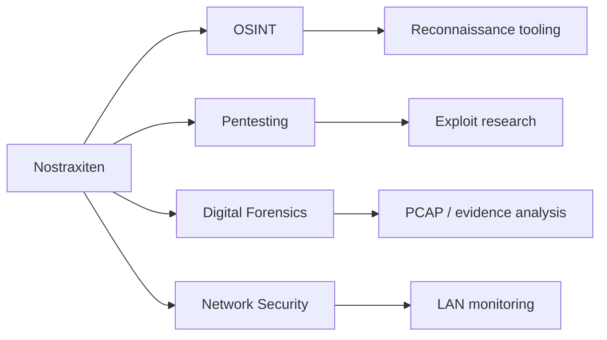

  

  
  
  

---

## About

Vocational IT student focused on **cybersecurity**, with a particular interest in **digital forensics (DFIR)** and **pentesting**. I build my own tools to understand systems from the inside, usually by breaking them first and rebuilding them properly afterward.

- Currently in my second year, studying programming, networking theory, and English
- Working toward a career in **Digital Forensics & Incident Response**
- Self-taught in security tooling, scripting, and offensive/defensive techniques

---

## Areas of Work

---

## Stack

| Category | Tools |
|---|---|
| **Languages** |      |
| **Systems** |      |
| **Security** |      |
| **Infra** |    |

---

## Featured Projects

| Project | Description |
|---|---|
| [**nostraxiten-framework**](https://github.com/Nostraxiten/nostraxiten-framework) | Modular security auditing, OSINT, and digital forensics (DFIR) framework with native reconnaissance and metadata-analysis modules |
| [**LookTheShark**](https://github.com/Nostraxiten/LookTheShark) | Forensic tool that analyzes `.pcap`/`.pcapng` captures (no `tshark` dependency) — HTTP, TLS/JA3, DNS, and credential extraction |
| [**NoxGuardian**](https://github.com/Nostraxiten/NoxGuardian) | Continuous home LAN monitoring: device presence tracking, session history, and open-port detection |
| [**Termux-Tools**](https://github.com/Nostraxiten/Termux-Tools) | 47-tool OSINT/pentesting toolbox in pure Python (standard library only) — no root, no external binaries |
| [**IPsearcher**](https://github.com/Nostraxiten/IPsearcher) | Discovers live hosts on authorized networks and checks open TCP ports, with false-positive filtering |
| [**LookThePerson**](https://github.com/Nostraxiten/LookThePerson) | Turns a webcam into a real-time control interface using computer vision models |
| [**NoxGrabber**](https://github.com/Nostraxiten/NoxGrabber) | Passive reconnaissance tool that collects device/OS information from a link, without credential theft |
| [**TerminuX**](https://github.com/Nostraxiten/TerminuX) | Visual mod for Termux: dark theme, syntax-highlighted `nano`, Kali-style prompt |
| [**php-freebase**](https://github.com/Nostraxiten/php-freebase) | Secure-by-default PHP starter base — admin panel, PDO prepared statements, CSRF protection |
| Project | CVEs | Description |
| [**PHP2Shell**](https://github.com/Nostraxiten/PHP2shell) |   | Unauthenticated RCE chain: OOM memory corruption + stale global state in PHP core. Two-stage ASLR bypass (Zend heap + libphp), session.upload_progress write primitive. Tested on Debian 12 / Apache mod_php |

---

## Stats

  

  

